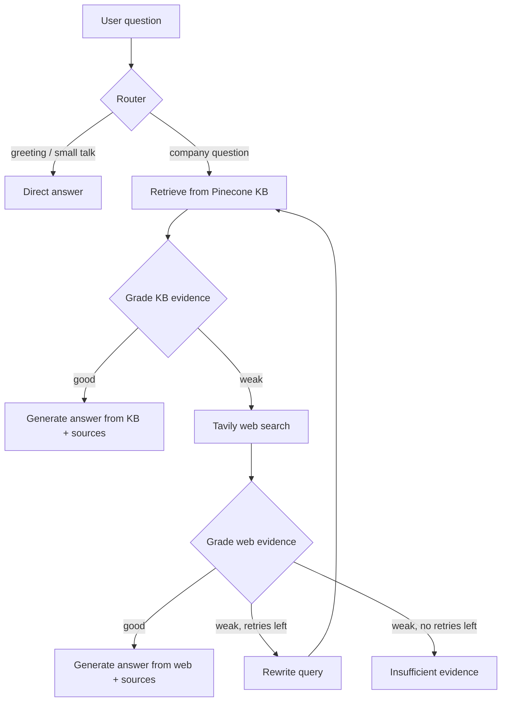

# Enterprise RAG: Agentic Knowledge Copilot

An agentic Retrieval-Augmented Generation (RAG) assistant that answers employee questions from a **private company knowledge base first**, and only reaches for **external web search when internal evidence is weak**. Every answer ends with the sources it was built from.

The demo company is the fictional **Nexora Technologies**, with sample IT, HR and compliance documents.

> Add a screenshot or short GIF of the chat UI here: `docs/screenshot.png`

---

## Why this project

A plain RAG pipeline always retrieves, always answers, and rarely admits when it does not know. This project adds decision-making around retrieval:

- It **routes** each question: greetings do not need a database lookup.
- It **grades** the retrieved evidence before answering, so weak context does not turn into a confident wrong answer.
- It **falls back** to web search only when the private KB cannot answer, and labels those answers as external information.
- It **rewrites** the query and retries a limited number of times, then says "insufficient evidence" instead of guessing.
- It **cites** its sources on every answer, so people can verify policy answers.

## How it works



The workflow is a [LangGraph](https://langchain-ai.github.io/langgraph/) state graph. Each node reads and updates a shared `AgentState` (question, current query, retrieved docs, grades, answer, citations, retry count and a step-by-step trace).

| Node | What it does |
|---|---|
| `route_question` | Classifies the question as `kb` or `direct` using structured JSON output |
| `retrieve_kb` | Fetches the most relevant chunks from the Pinecone index |
| `grade_kb` | LLM judges whether the evidence is enough (`good` / `weak`) |
| `search_web` | Tavily search, used only when the KB grade is weak |
| `grade_web` | Judges the web evidence the same way |
| `rewrite_query` | Rewrites the question for better retrieval, then loops back |
| `generate_from_kb` / `generate_from_web` | Writes the answer from the evidence and appends a **Sources** list |
| `insufficient` | Stops cleanly when no reliable evidence exists |

## Features

- Agentic routing, grading, fallback and retry logic with LangGraph
- Private knowledge base on Pinecone with HuggingFace embeddings
- Document ingestion for PDF, DOCX and text files, split into chunks
- Web search fallback with Tavily, clearly labelled as external information
- Source citations on every KB and web answer
- Evidence label on each response (`private_kb`, `web_search`, `direct`, `insufficient_evidence`)
- FastAPI backend with a Jinja2 chat interface
- Lazy-loaded LLM and search clients, with clear errors when API keys are missing

## Tech stack

| Layer | Tools |
|---|---|
| Orchestration | LangGraph, LangChain |
| LLM | Groq (`langchain-groq`) |
| Vector store | Pinecone (`langchain-pinecone`) |
| Embeddings | HuggingFace / sentence-transformers |
| Web search | Tavily (`langchain-tavily`) |
| Backend | FastAPI, Uvicorn, Pydantic Settings |
| Frontend | Jinja2 templates, static HTML/CSS/JS |
| Document parsing | pypdf, python-docx |

## Project structure

```
Enterprise-RAG/
├── app/
│   ├── main.py              # FastAPI app, static files and templates
│   ├── api/
│   │   └── route.py         # HTTP routes
│   ├── core/
│   │   └── config.py        # Settings loaded from .env
│   ├── rag/
│   │   ├── state.py         # AgentState and structured-output models
│   │   ├── workflow.py      # LangGraph nodes and graph
│   │   └── vectorstore.py   # Pinecone setup, retriever, add_documents
│   ├── services/
│   │   └── ingestion.py     # File loading and chunking
│   ├── static/              # CSS / JS
│   └── templates/           # Chat UI
├── data/                    # Sample knowledge base documents
├── ingest_sample_kb.py      # Index the sample KB into Pinecone
├── run.py                   # Start the dev server
├── requirements.txt
└── .env                     # API keys (never commit this)
```

## Getting started

### Prerequisites

- Python 3.11 or newer
- A [Groq](https://console.groq.com/) API key
- A [Pinecone](https://www.pinecone.io/) API key and an index whose **dimension matches your embedding model**
- A [Tavily](https://tavily.com/) API key

### 1. Clone and install

```bash
git clone https://github.com/<your-username>/Enterprise-RAG.git
cd Enterprise-RAG

python -m venv .venv
# Windows
.venv\Scripts\activate
# macOS / Linux
source .venv/bin/activate

pip install -r requirements.txt
```

### 2. Configure environment variables

Create a `.env` file in the project root. Use the exact variable names defined in `app/core/config.py`:

```env
GROQ_API_KEY=your_groq_key
GROQ_MODEL=your_groq_model_name
TAVILY_API_KEY=your_tavily_key
PINECONE_API_KEY=your_pinecone_key
PINECONE_INDEX_NAME=your_index_name
```

### 3. Ingest the sample knowledge base

Put your documents in the folder set as the sample KB directory, then run:

```bash
python ingest_sample_kb.py
```

You should see a line like `Indexed N files -> M chunks -> M ids`.

> Re-ingesting the same files adds duplicate vectors. Clear the index or use a new namespace first if you want a clean re-index.

### 4. Run the app

```bash
python run.py
```

Open **http://127.0.0.1:8000**. Interactive API docs are at **http://127.0.0.1:8000/docs**.

## Example questions

| Question | Expected path |
|---|---|
| "hi" | Router → direct answer |
| "How many annual leave days do employees receive?" | Router → KB → answer with sources |
| "What is our password reset policy?" | Router → KB → answer with sources |
| "Latest Microsoft Teams outage guidance" | KB weak → web search → labelled external answer |
| A question nothing can answer | KB weak → web weak → rewrite → insufficient evidence |

## Design decisions

- **Private knowledge first.** Internal documents are the source of truth. Web results are a labelled fallback, not a replacement.
- **Grade before answering.** A separate LLM call checks evidence quality, which cuts down on confident answers built from irrelevant chunks.
- **Bounded retries.** `max_retries` caps the rewrite loop so cost and latency stay predictable.
- **Sources added in code, not by the model.** Citations are appended programmatically, so they do not depend on the LLM remembering to include them.
- **Structured outputs.** Routing and grading use JSON-mode structured output so the graph can branch reliably.

## Known limitations

- Personal data (such as an individual's leave balance) is not in the knowledge base, so the assistant can only explain the policy.
- Questions that grade as weak are sent to an external search service. Review this before using real internal data.
- Answer quality depends on chunking, embedding model and retriever settings, and has not been benchmarked formally.
- No authentication or per-user access control yet.

## Roadmap

- [ ] Evaluation set with retrieval and answer-quality metrics
- [ ] Conversation memory across turns
- [ ] Role-based access to document collections
- [ ] Restrict web fallback to external or vendor-related questions
- [ ] Streaming responses
- [ ] Docker setup and deployment guide

## License

See [LICENSE](LICENSE).